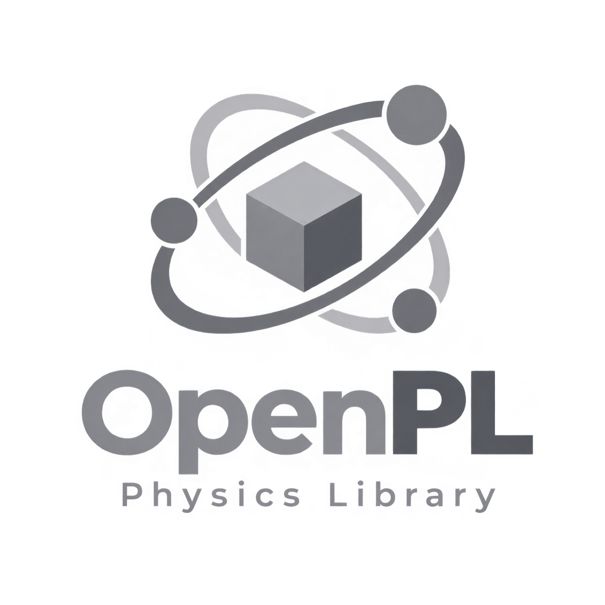

  
  <h1>OpenPL</h1>
  

    C/C++ and Java bindings over <strong>Bullet Physics</strong> for rigid bodies,
    constraints, vehicles, characters and soft bodies.
  

  

    
    
    
    
  

  

    <a class="openpl-btn openpl-btn--primary" href="es/">Documentación (Español)</a>
    <a class="openpl-btn" href="en/">Documentation (English)</a>
    <a class="openpl-btn" href="https://github.com/FSSRepo/openpl-physics-engine">GitHub</a>
  

  

    <h3>Simple queue-based API</h3>
    
Generate, bind and create with an OpenGL-style workflow — no deep Bullet knowledge required.

  

  

    <h3>Cross-platform</h3>
    
Build on Windows, Linux and Android from a single C/C++ core with optional Java bindings.

  

  

    <h3>Full feature set</h3>
    
Collision shapes, 11 constraint types, raycast vehicles, kinematic characters and soft bodies.

  

  

    <h3>Multithreaded</h3>
    
Optional multithreading powered by Bullet's internal task scheduler.

  

